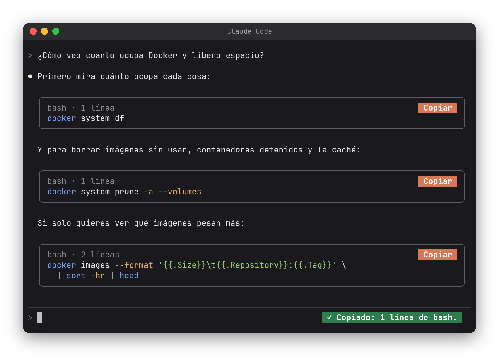

# 📋 Copiar — un botón Copiar en cada bloque de código de Claude Code

Un mod para [Claude Code](https://claude.com/claude-code) que encierra cada bloque de código de las respuestas de Claude en un recuadro con un botón **Copiar**. Un clic y el comando, la consulta o el texto queda en tu portapapeles, exacto, sin seleccionar con el ratón ni arrastrar la viñeta o la sangría.



## Instalación

Escribe esto en el prompt de Claude Code:

```
/plugin install copiar --marketplace waldooCreator/claude-code-copiar
```

Responde `y` para agregar el marketplace y elige el alcance **user** (Enter). Desde ahí funciona en todas tus sesiones. No hay que configurar nada.

<details>
<summary>Otras formas de instalarlo</summary>

Desde una terminal normal:

```bash
claude plugin install copiar --marketplace waldooCreator/claude-code-copiar
```

Probarlo sin instalar:

```bash
git clone https://github.com/waldooCreator/claude-code-copiar.git
claude --plugin-dir ./claude-code-copiar
```

</details>

## Qué hace

- 📦 **Un recuadro por bloque**, con el lenguaje y el número de líneas arriba: `sql · 3 líneas`.
- 🖱️ **Botón Copiar**: copia el contenido exacto del bloque. Un aviso confirma qué se copió.
- 🧹 **Sin basura**: si el bloque venía dentro de una lista, se le quita la sangría antes de copiar.
- ✍️ **Mientras Claude escribe**, el recuadro dice `escribiendo…` y el botón aparece cuando el bloque termina.
- 🧠 **Le enseña a Claude**: agrega una instrucción para que todo lo que sea para copiar (comandos, consultas, rutas, valores, textos para enviar) llegue en su propio bloque, sin explicaciones dentro.
- 🪶 **Si la respuesta no tiene bloques, no toca nada**: Claude Code la dibuja como siempre.

## Requisitos

En Linux, el botón usa la herramienta del portapapeles del sistema. Instala una si no la tienes:

| Sesión | Paquete |
| --- | --- |
| Wayland | `wl-clipboard` |
| X11 | `xclip` o `xsel` |

En macOS (`pbcopy`) y Windows (`clip`) ya viene incluida. Si no encuentra ninguna, copia con el portapapeles de Claude Code, que funciona en las terminales que lo permiten.

## Cómo funciona

```
hooks/register.tsx   dibuja los recuadros (ui.render de AssistantMessage) y agrega la instrucción para Claude (prompt.compose)
hooks/bloques.ts     parte el markdown en texto y bloques de código cercados
tests/               pruebas (claude plugin test)
```

El primer trozo de texto lo sigue dibujando Claude Code (con su viñeta y sus colores); el mod solo reemplaza los bloques de código por recuadros.

## Desarrollo

```bash
claude plugin test .      # corre las pruebas
claude --plugin-dir .     # abre una sesión con el mod cargado desde esta carpeta
```

<details>
<summary>🇬🇧 In English</summary>

**Copiar** ("copy") is a Claude Code mod that wraps every fenced code block in Claude's replies in a bordered box with a **Copy** button, so you can grab a command or query in one click without selecting text. It also tells Claude to put anything meant to be copied in its own code block. On Linux it needs `wl-clipboard` (Wayland) or `xclip`/`xsel` (X11).

Install: `/plugin install copiar --marketplace waldooCreator/claude-code-copiar`. The UI is in Spanish.

</details>

## Aviso

Proyecto personal, **no oficial**: no está afiliado a Anthropic ni cuenta con su respaldo.

## Licencia

[MIT](LICENSE)
