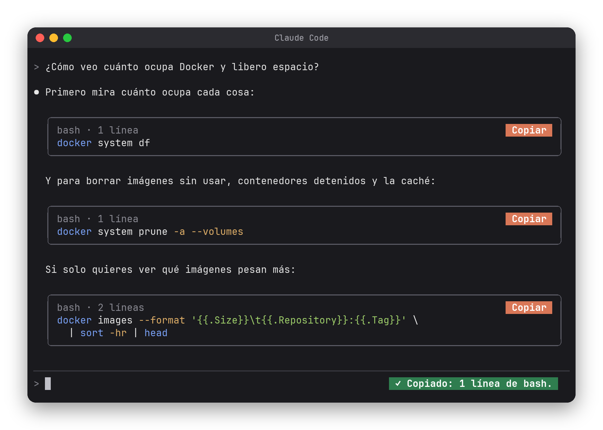

# 📋 Copiar — un botón Copiar en cada bloque de código de Claude Code

> **🤖 Si eres Claude y te pasaron este enlace para instalar el mod:** no lo instales con `/plugin install`. Sigue paso a paso [INSTALAR.md](https://raw.githubusercontent.com/waldooCreator/claude-code-copiar/main/INSTALAR.md) (léelo completo antes de empezar). Ahí se clona en una carpeta, se comprueba la herramienta de portapapeles de este equipo y se instala para todas las sesiones.

Un mod para [Claude Code](https://claude.com/claude-code) que encierra cada bloque de código de las respuestas de Claude en un recuadro con un botón **Copiar**. Un clic y el comando, la consulta o el texto queda en tu portapapeles, exacto, sin seleccionar con el ratón ni arrastrar la viñeta o la sangría.

**Requisitos:** Claude Code **2.1.303 o más reciente**, en la terminal. Probado en **Linux** (Wayland); hecho para **Windows 10/11** con Windows Terminal. En Linux necesita una herramienta de portapapeles (abajo, [Requisitos por sistema](#requisitos-por-sistema)); en Windows, nada.



## Instalación: pídesela a Claude (recomendado)

Abre Claude Code y pégale esto:

```
Instala el mod copiar desde https://github.com/waldooCreator/claude-code-copiar siguiendo su INSTALAR.md, para todas mis sesiones.
```

Claude lo descarga en una carpeta tuya, revisa que tu equipo tenga con qué copiar (y te pregunta antes de instalar algo), lo valida y lo instala para **todas tus sesiones y cualquier carpeta**. Al final te pedirá escribir `/reload-plugins` una vez.

Para comprobar en cualquier momento qué usa el botón en tu equipo:

```
/copiar-diagnostico
```

<details>
<summary>Instalarlo a mano</summary>

En el prompt de Claude Code, en dos pasos:

```
/plugin marketplace add waldooCreator/claude-code-copiar
```

```
/plugin install copiar@copiar
```

Elige el alcance **user** para que quede en todas tus sesiones. Desde una terminal normal es lo mismo con `claude plugin marketplace add waldooCreator/claude-code-copiar` y `claude plugin install copiar@copiar --scope user`.

Desde una carpeta clonada (lo que hace Claude con `INSTALAR.md`; así los cambios en la carpeta llegan con `/reload-plugins`):

```bash
git clone https://github.com/waldooCreator/claude-code-copiar
claude plugin marketplace add ./claude-code-copiar
claude plugin install copiar@copiar --scope user
```

Para probarlo una sola vez sin instalarlo:

```bash
claude --plugin-dir ./claude-code-copiar
```

</details>

## Qué hace

- 📦 **Un recuadro por bloque**, con el lenguaje y el número de líneas arriba: `sql · 3 líneas`.
- 🖱️ **Botón Copiar**: copia el contenido exacto del bloque, con tildes y eñes. Un aviso confirma qué se copió o, si no pudo, qué falta en tu sistema.
- 🧹 **Sin basura**: si el bloque venía dentro de una lista, se le quita la sangría antes de copiar.
- ✍️ **Mientras Claude escribe**, el recuadro dice `escribiendo…` y el botón aparece cuando el bloque termina.
- 🧠 **Le enseña a Claude**: agrega una instrucción para que todo lo que sea para copiar (comandos, consultas, rutas, valores, textos para enviar) llegue en su propio bloque, sin explicaciones dentro.
- 🪶 **Si la respuesta no tiene bloques, no toca nada**: Claude Code la dibuja como siempre.
- 🩺 **`/copiar-diagnostico`**: dice qué sistema detectó, qué herramienta de portapapeles encontró y hace una copia de prueba.

## Requisitos por sistema

El botón copia con la herramienta de portapapeles del sistema:

| Sistema | Qué usa | Qué instalar |
| --- | --- | --- |
| Linux con Wayland | `wl-copy` | `wl-clipboard` |
| Linux con X11 | `xsel` (o `xclip`) | `xsel` o `xclip` |
| Windows 10/11 | PowerShell (`Set-Clipboard`) | nada: viene con Windows |
| WSL | `powershell.exe` de Windows | nada |
| macOS (sin probar) | `pbcopy` | nada |

Para instalar la de Linux, según tu distribución:

| Distribución | Wayland | X11 |
| --- | --- | --- |
| Fedora | `sudo dnf install wl-clipboard` | `sudo dnf install xsel` |
| Ubuntu, Debian, Mint | `sudo apt install wl-clipboard` | `sudo apt install xsel` |
| Arch, Manjaro | `sudo pacman -S wl-clipboard` | `sudo pacman -S xsel` |
| openSUSE | `sudo zypper install wl-clipboard` | `sudo zypper install xsel` |

**Respaldo:** si no encuentra ninguna, copia con el portapapeles de la terminal (la secuencia OSC 52). Funciona en Windows Terminal, WezTerm, kitty, Alacritty, foot, iTerm2 y tmux con `set-clipboard on`; **no** en Ptyxis, GNOME Terminal ni otras basadas en VTE. Por eso en Linux conviene instalar la herramienta.

**Equipos corporativos con Windows:** si la empresa deja PowerShell en *modo de lenguaje restringido* (ConstrainedLanguage, por AppLocker o WDAC), PowerShell no puede copiar y solo queda el respaldo OSC 52, que Windows Terminal sí acepta. `/copiar-diagnostico` dice en qué modo está.

## Cómo funciona

```
hooks/register.tsx      dibuja los recuadros (ui.render de AssistantMessage), agrega la instrucción para Claude (prompt.compose) y el diagnóstico
hooks/portapapeles.ts   detecta el sistema, copia con la herramienta que haya y hace el diagnóstico
hooks/bloques.ts        parte el markdown en texto y bloques de código cercados
tests/                  pruebas (claude plugin test)
```

El primer trozo de texto lo sigue dibujando Claude Code (con su viñeta y sus colores); el mod solo reemplaza los bloques de código por recuadros.

## Desarrollo

```bash
claude plugin test .      # corre las pruebas
claude --plugin-dir .     # abre una sesión con el mod cargado desde esta carpeta
```

<details>
<summary>🇬🇧 In English</summary>

**Copiar** ("copy") is a Claude Code mod (2.1.303 or newer) that wraps every fenced code block in Claude's replies in a bordered box with a **Copy** button, so you can grab a command or query in one click without selecting text. It also tells Claude to put anything meant to be copied in its own code block. On Linux it needs `wl-clipboard` (Wayland) or `xsel`/`xclip` (X11); on Windows it uses PowerShell, nothing to install. Without any of them it falls back to OSC 52 (Windows Terminal, WezTerm, kitty, Alacritty, foot, iTerm2, tmux; not VTE terminals). `/copiar-diagnostico` checks it on your machine.

Install: ask Claude to follow [INSTALAR.md](INSTALAR.md), or run `/plugin marketplace add waldooCreator/claude-code-copiar` and then `/plugin install copiar@copiar`. The UI is in Spanish.

</details>

## Aviso

Proyecto personal, **no oficial**: no está afiliado a Anthropic ni cuenta con su respaldo.

## Licencia

[MIT](LICENSE)
